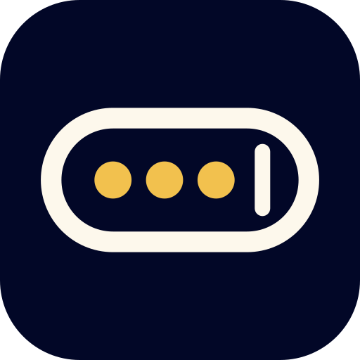
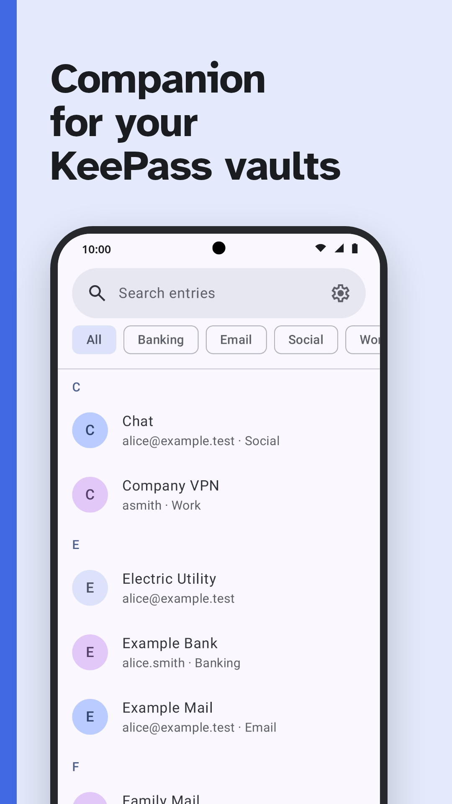
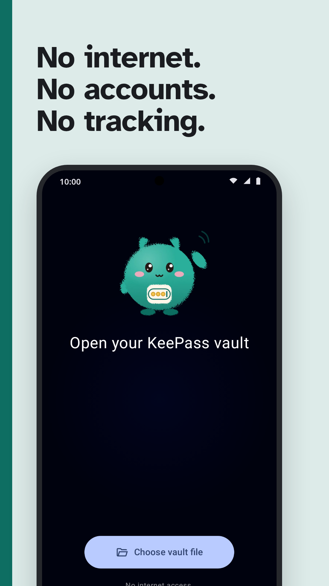
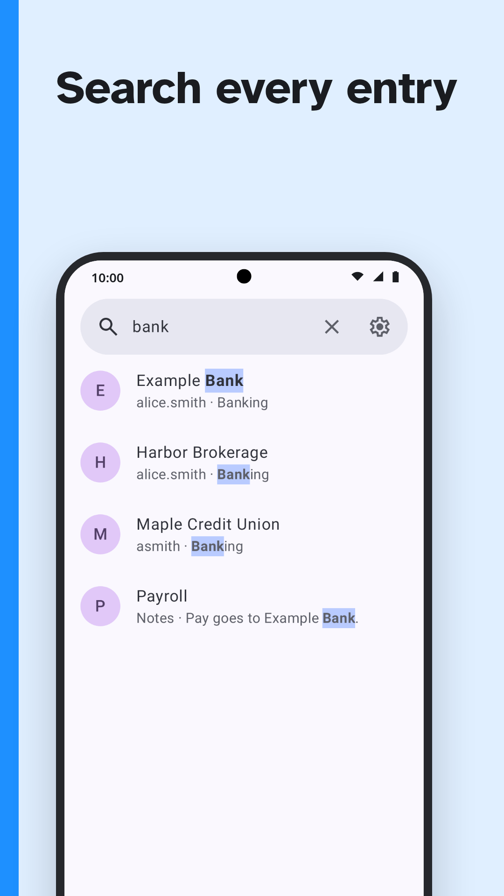
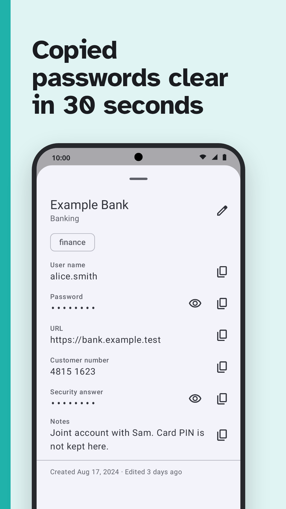
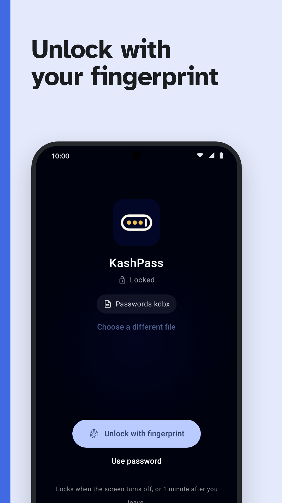
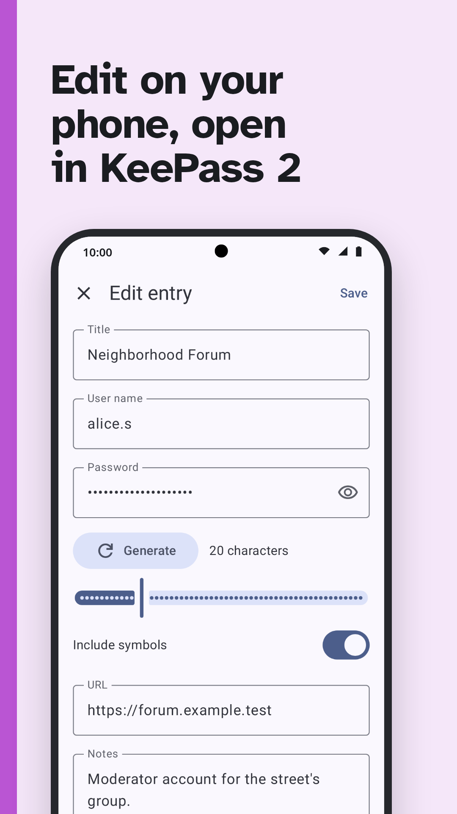
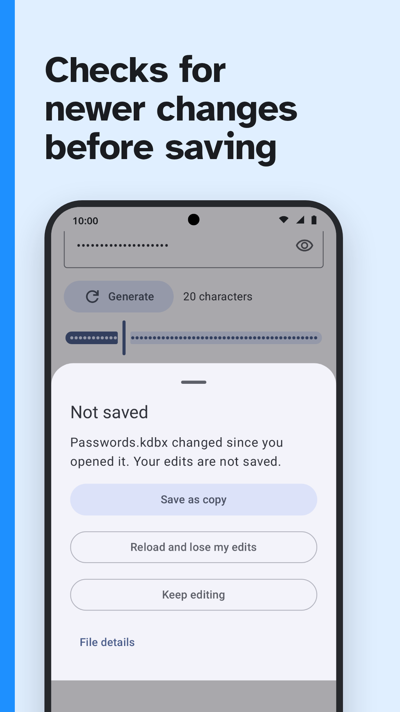
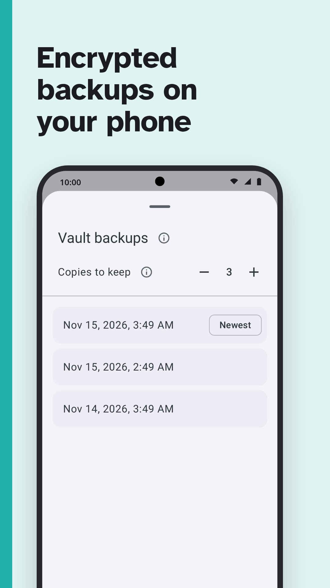
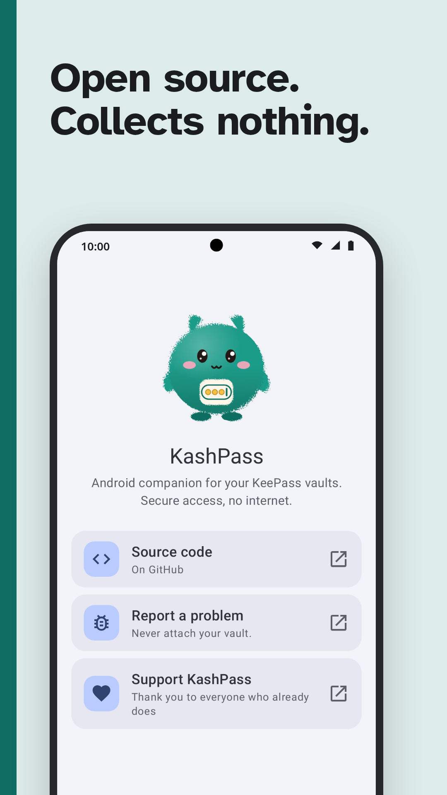

<div align="center">



# KashPass™

**Android companion for your KeePass vaults. Secure access, no internet.**

[](https://github.com/OneKashLabs/KashPass/releases)
[](LICENSE)
[](https://github.com/sponsors/one-kash)

APK signing certificate (SHA-256):<br>
`D4:B7:D3:9C:9F:AD:18:9B:C4:17:C6:44:11:00:5E:BD:5F:78:1A:F2:3D:74:62:C1:C0:99:1C:5E:DD:04:4F:E0`

---

<table>
<tr>
<td></td>
<td></td>
<td></td>
</tr>
<tr>
<td></td>
<td></td>
<td></td>
</tr>
<tr>
<td></td>
<td></td>
<td></td>
</tr>
</table>

---

</div>

## Your vault, on your phone

You keep your vault in a storage app, such as a cloud drive, and manage it in KeePass 2 on your
computer. KashPass opens the same file on your phone: find a login, copy the password, edit an
entry, and save back to the same file. KeePass 2 opens the saved file.

KashPass has no internet permission, no accounts and no ads, and collects nothing. It reads and
writes only the file you pick. It is an independent app, not affiliated with KeePass.

## What it does

- Opens KDBX 4.0 and 4.1 vaults with a password, a key file, or both. Encryption: AES-256 or
  ChaCha20, with AES-KDF, Argon2d or Argon2id key derivation.
- Opens the vault through Android's file picker, or from a file manager with Open with.
- Lists entries A to Z with group filters. Search covers titles, user names, URLs, notes, tags and
  custom fields. Passwords and protected fields are never searched.
- Shows every field, with reveal and copy. A copied value is marked sensitive and cleared after 30
  seconds.
- Adds, edits and deletes entries the way KeePass 2 does: each change keeps the old version in the
  entry's history, and deleted entries go to the recycle bin when the vault has one.
- Unlocks with a fingerprint or face once you turn it on (Class 3 biometrics only).
- Locks when the screen turns off, one minute after you leave the app, or when you lock it.

## Safe saving

- Before each save, KashPass checks that the file hasn't changed since you opened it. After
  writing, it reads the file back and decrypts it. If either check fails, it tells you and keeps
  your edits.
- Each open and save keeps an encrypted copy of the vault in app-private storage. If the file
  can't be read, KashPass opens the newest copy read-only, and you can save it as a new file.

### With KeePass 2 and a cloud drive

Save on one device and let your storage app finish syncing before you edit on the other.

If a newer version has already reached the phone, KashPass doesn't save and offers three choices:
save your edits as a copy (then merge it in KeePass 2 with File, Synchronize), reload, or keep
editing. A newer version that hasn't reached the phone yet can't be seen: the phone's save becomes
the latest version, and the computer's version stays in the storage app's version history, if it
keeps one, from where File, Synchronize merges it back.

If an older copy of the vault comes back, for example restored from version history, KashPass
tells you when it opens it.

## Private and locked down

- No internet permission. Two permissions in all: biometric, and hiding other apps' overlays. Both
  are granted at install.
- Key-derivation settings are checked before any key work. KashPass refuses unsafe values, and
  refuses a file whose settings got weaker since you last opened it, a sign the file was replaced.
- Decrypted entries, passwords and key files are never written to disk or to logs.
- Screenshots, screen recording and other apps' overlays are blocked. Autofill is off in the app,
  and the keyboard is asked not to learn what you type in password fields.
- No analytics or tracking. See [PRIVACY.md](PRIVACY.md).

## How it's tested

- Before each release, KeePass 2's own library opens every vault KashPass saves in the tests,
  after each kind of edit. KeePass 2 on Windows opens and saves the test vaults, and KashPass
  opens what it saved.
- Key derivation is checked against the RFC 9106 test vectors and 820 cases from the Argon2
  reference implementation.
- The vault reader and writer are fuzzed with Jazzer and property-tested with random vaults and
  edit sequences.
- The default suite runs 2,590 unit tests.

## What it doesn't do

No autofill, sync servers, creating vaults, KDBX 3, opening attachments or TOTP codes. Attachments
and everything else you don't edit are kept when you save. Create and manage your vault in
[KeePass 2](https://keepass.info/); every file KashPass saves opens there.

## Requirements

- Android 12 or later.
- A KDBX 4 vault. KeePass 2.57 and later always save KDBX 4. Earlier versions, from 2.35, save
  KDBX 4 once the vault uses Argon2 (File, Database Settings, Security); a KDBX 3.1 file converts
  the same way.
- Tested with KeePass 2.62.

## Verify your download

Each release on [GitHub Releases](https://github.com/OneKashLabs/KashPass/releases) lists the
APK's SHA-256. [AppVerifier](https://github.com/soupslurpr/AppVerifier) or
`apksigner verify --print-certs` shows the signing certificate, which must match the one above.
Release APKs are reproducible: building the release commit gives the same APK, apart from its
signature.

---

<details>
<summary><strong>For developers</strong></summary>

### Build

```bash
git clone https://github.com/OneKashLabs/KashPass.git
cd KashPass
./gradlew assembleDebug
./gradlew :vault-core:test testDebugUnitTest
```

Requires JDK 21 and an Android SDK with platform 37 (`sdk.dir` in `local.properties`).
`./gradlew assembleRelease` builds an unsigned release APK; releases are signed afterwards with
`apksigner`.

### How it is built

- `vault-core`: pure Kotlin. KDBX 4 reading and writing, key derivation and the open and save
  checks, tested on the JVM.
- `app`: Jetpack Compose UI with Material 3, and the file access through Android's file picker.
- KDBX parsing and cryptography are KashPass's own code, with no third-party KDBX or crypto
  library. Every file KashPass saves is tested to open in KeePass 2.
- Dependencies are pinned and checksum-verified (`gradle/verification-metadata.xml`).

See [CONTRIBUTING.md](CONTRIBUTING.md). Report security issues privately, as described in
[SECURITY.md](SECURITY.md).

</details>

---

<div align="center">

**[Issues](https://github.com/OneKashLabs/KashPass/issues)** · **[Releases](https://github.com/OneKashLabs/KashPass/releases)** · **[Changelog](CHANGELOG.md)** · **[Privacy](PRIVACY.md)** · **[Security](SECURITY.md)**

Copyright (C) 2026 onekash labs. Licensed under the [GNU Affero General Public License v3.0](LICENSE)
or (at your option) any later version. Third-party notices: [NOTICE](NOTICE).
The KashPass name and icon are trademarks of onekash labs and are not covered by the AGPL.
Commercial license: [LICENSING.md](LICENSING.md).

</div>
